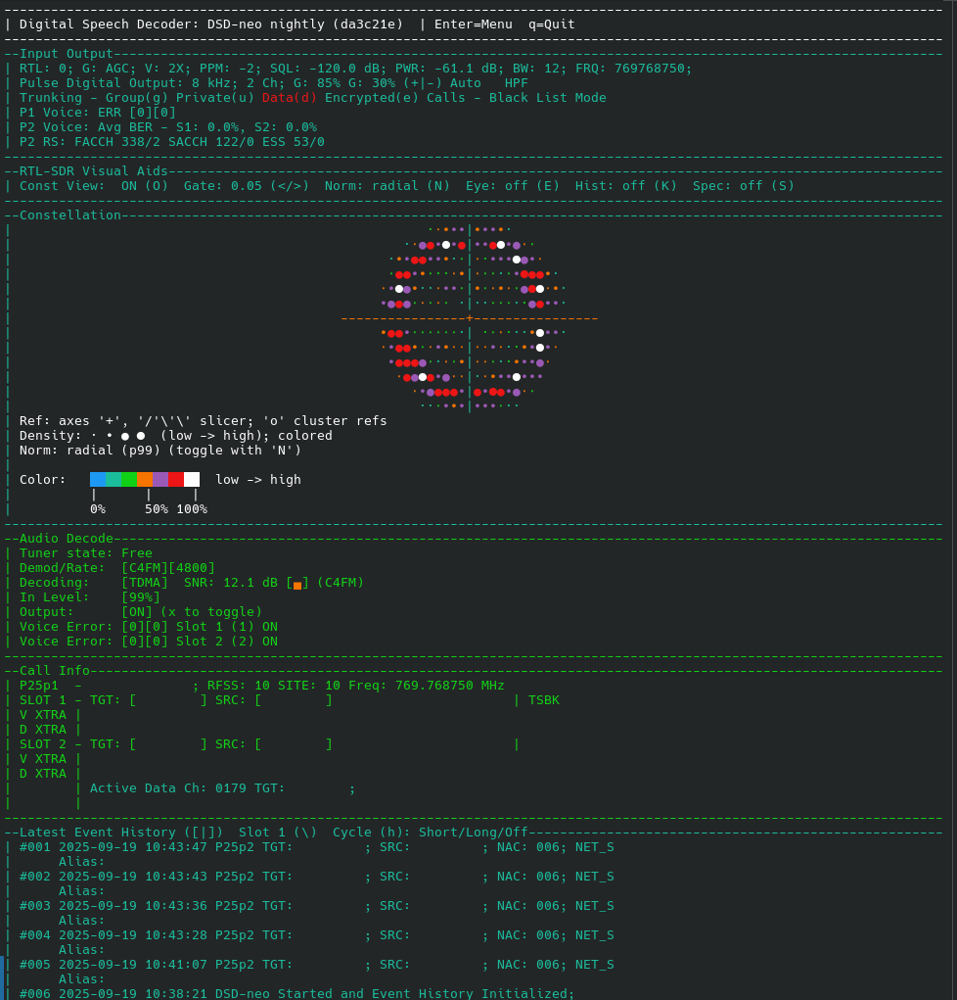

# DSD-neo

DSD-neo decodes digital two-way radio. Feed it a signal from an SDR dongle, a scanner's audio output, or an audio
stream from SDR software, and it plays the voice and shows who is talking: talkgroups, radio IDs, names, and the
system and site. It can follow trunked systems from channel to channel by itself, and scan several systems with one
radio.

It runs on Linux, macOS, Windows and Android. On a computer it is a command-line program with an optional full-screen
terminal display; on Android it is a touch app.

DSD-neo started as a fork of [DSD-FME](https://github.com/lwvmobile/dsd-fme), itself a fork of the original
[DSD](https://github.com/szechyjs/dsd) (Digital Speech Decoder).

[](https://github.com/arancormonk/dsd-neo/actions/workflows/linux-ci.yaml)
[](https://github.com/arancormonk/dsd-neo/actions/workflows/windows-ci.yaml)
[](https://github.com/arancormonk/dsd-neo/actions/workflows/macos-ci.yaml)
[](https://github.com/arancormonk/dsd-neo/actions/workflows/android-ci.yaml)
[](https://www.bestpractices.dev/projects/12978)
[](https://www.bestpractices.dev/projects/12978)



## Download

Stable releases are on [GitHub Releases](https://github.com/arancormonk/dsd-neo/releases/latest), with file names like
the ones below (`v<version>` is the release tag, for example `v2.12.1`). Nightly builds come from the latest `main`
branch: they have the newest fixes but less testing. Each file has an `.spdx.json` list of what is inside it, and
[docs/release-verification.md](docs/release-verification.md) shows how to check a download.

| Platform | Stable | Nightly |
| --- | --- | --- |
| Android (arm64, Android 10 or newer) | [Google Play](https://play.google.com/store/apps/details?id=io.github.arancormonk.dsdneo), or `dsd-neo-android-arm64-app-v<version>.apk` | [APK](https://github.com/arancormonk/dsd-neo/releases/download/nightly/dsd-neo-android-arm64-app-nightly.apk) |
| Linux x86_64 (AppImage) | `dsd-neo-linux-x86_64-portable-v<version>.AppImage` | [AppImage](https://github.com/arancormonk/dsd-neo/releases/download/nightly/dsd-neo-linux-x86_64-portable-nightly.AppImage) |
| Linux aarch64 (AppImage) | `dsd-neo-linux-aarch64-portable-v<version>.AppImage` | [AppImage](https://github.com/arancormonk/dsd-neo/releases/download/nightly/dsd-neo-linux-aarch64-portable-nightly.AppImage) |
| macOS (Apple Silicon; no Intel build) | `dsd-neo-macos-arm64-portable-v<version>.dmg` | [DMG](https://github.com/arancormonk/dsd-neo/releases/download/nightly/dsd-neo-macos-arm64-portable-nightly.dmg) |
| Windows x86_64 | `dsd-neo-msvc-x86_64-native-v<version>.zip` | [ZIP](https://github.com/arancormonk/dsd-neo/releases/download/nightly/dsd-neo-msvc-x86_64-native-nightly.zip) |

On Arch Linux, install [dsd-neo](https://aur.archlinux.org/packages/dsd-neo) from the AUR for stable releases, or
[dsd-neo-git](https://aur.archlinux.org/packages/dsd-neo-git) to build the latest `main`.

Getting started with a download:

- **Linux AppImage:** make it executable and run it: `chmod +x dsd-neo-linux-*.AppImage`, then
  `./dsd-neo-linux-*.AppImage -h`. It needs glibc 2.31 or newer (Ubuntu 20.04 or later). An RTL-SDR dongle needs the
  usual USB permissions (udev rules).
- **macOS DMG:** copy the `dsd-neo-macos` folder out of the DMG, then run `./dsd-neo.sh -h` in Terminal from inside it.
  If macOS refuses to run it, run `xattr -dr com.apple.quarantine .` once from inside that folder, or allow it under
  System Settings → Privacy & Security. The build plays audio through PulseAudio:
  `brew install pulseaudio && brew services start pulseaudio`.
- **Windows ZIP:** unzip it and run `bin\dsd-neo.exe -h` from a terminal in the unzipped folder. An RTL-SDR dongle
  needs the WinUSB driver, which you install once with [Zadig](https://zadig.akeo.ie/). An Airspy normally needs
  nothing ([docs/airspy.md](docs/airspy.md)).

### Android: Google Play or the APK

The app runs on 64-bit ARM phones and tablets (arm64-v8a) with Android 10 or newer. You can install it from
[Google Play](https://play.google.com/store/apps/details?id=io.github.arancormonk.dsdneo), which keeps it up to date
for you, or side-load the APK from GitHub. Every APK on GitHub is signed with the same project key, so the nightly and
stable APKs install over each other.

The Google Play build is signed with a different key, so it will not install over a side-loaded APK, and a side-loaded
APK will not install over it. To switch to the Google Play build, uninstall the side-loaded app first. Uninstalling
deletes the app's data, so first save a backup (Settings → **Backup**, see
[Backup and restore](android/README.md#backup-and-restore)) somewhere outside the app, such as Downloads or cloud
storage, and restore it after you install from Google Play. A backup does not include call history or call recordings,
so share or export any recordings you want to keep before you uninstall. Switching back to a side-loaded APK works the
same way.

The two builds also differ in file access: Google Play does not allow the "All files access" permission, so on
Android 11 and newer the Google Play build's file browser sees only its own files. Pick files with Android's file
picker there.

## What It Decodes

- **DMR**, conventional and trunked (Tier III, Capacity Plus, Capacity Max, Connect Plus and Hytera XPT).
- **P25 Phase 1 and Phase 2**, conventional and trunked, including simulcast (LSM) sites.
- **NXDN** (NXDN48 and NXDN96), conventional and trunked.
- **TETRA**, trunked and direct mode, with speech.
- **EDACS** (trunked) and **ProVoice**.
- **dPMR**, **D-STAR**, **YSF** (Yaesu System Fusion) and **X2-TDMA**.
- **M17** over the air and over UDP/IP, with an M17 encoder for testing.
- **Analog FM and AM**, with squelch, and CTCSS/DCS tone filtering on FM.

Along with voice it shows talker aliases, text messages and radio locations (GPS/LRRP) where the system sends them.
Encrypted calls need their key: see "Keys & Privacy" in [docs/cli.md](docs/cli.md), or
[decryption profiles](docs/decryption-profiles.md) in the Android app.

## What It Does

- **Works with the radio you have.** RTL-SDR dongles and Airspy R2 and Mini receivers over USB (on Android too, over
  USB-OTG), or an `rtl_tcp` server on another computer. It can also take audio from SDR++ or other SDR software over
  TCP or UDP, or from a file. On a computer it also reads other SDRs through SoapySDR (SDRplay, HackRF, LimeSDR,
  RX-888 and more) once you install the SoapySDR module for your radio ([docs/soapysdr.md](docs/soapysdr.md)), and
  your sound card.
- **Follows trunked systems.** It listens to the control channel and tunes to each call as it starts. Talkgroup and
  radio ID lists put names on calls, and can block, mute or skip recording for any talkgroup or radio.
- **Scans with one radio.** Trunk scan rotates one tuner across a list of P25, DMR and NXDN systems and single digital
  or analog FM/AM frequencies ([docs/trunk-scan.md](docs/trunk-scan.md)). Conventional scan (`-Y`) steps through a
  channel list. In the Android app, Signal search finds active frequencies across a range
  ([docs/signal-search.md](docs/signal-search.md)).
- **Imports systems from RadioReference.com**, in the Android app and the terminal display, so you don't have to write
  the channel and talkgroup files by hand. It needs your own RadioReference premium subscription, and on a computer
  also your own RadioReference application key ([docs/radioreference-import.md](docs/radioreference-import.md)).
- **Records and logs.** It saves each call as a WAV file, keeps an event history and uploads calls to rdio-scanner. On a
  computer it can also record raw I/Q from the radio to replay later.
- **Helps you set up.** With a radio input, the terminal display shows a constellation view, an eye diagram, a spectrum,
  and live signal quality readouts. RTL-SDR users get bias-tee control, gain, squelch, and automatic frequency-error
  (PPM) correction.
- **Works with other programs.** It can retune SDR++ over rigctl to follow a trunked system, take retune commands over
  UDP ([docs/udp-control.md](docs/udp-control.md)), and on a computer it serves a JSON control and telemetry API
  ([docs/api.md](docs/api.md)).

On a computer DSD-neo runs from a terminal: there is no desktop window app yet. The Android app is a full touch app
with saved systems, scan lists, call history and backup.

Compared with DSD-FME, DSD-neo adds TETRA; a fuller M17 implementation (packet, BERT, M17 over UDP/IP, decryption,
signature checks and encoders); SoapySDR, Airspy and UDP audio input; AM and CTCSS/DCS tone filtering; I/Q capture and
replay; RadioReference import; trunk scanning across several systems with one radio; the terminal's signal views; an
Android app; and ready-to-run packages for Linux, macOS, Windows and Android (DSD-FME ships a Windows build only).
Compared with the original DSD it adds P25 Phase 2, M17, YSF, TETRA, EDACS trunking, trunk following, network inputs,
radio control and an interactive display.

## Quick Start

Running `dsd-neo` with no options in a terminal starts an interactive setup that asks for your input, mode, trunking,
output and display (unless a config file is loaded). With a download, use `./dsd-neo-linux-*.AppImage`,
`./dsd-neo.sh` or `bin\dsd-neo.exe` in place of `dsd-neo`. A few common starting points (`--frontend terminal` opens
the full-screen display):

```sh
# Show every option
dsd-neo -h

# Listen on one frequency with an RTL-SDR dongle
# (rtl:device:frequency:gain:ppm:bandwidth_kHz:squelch:volume)
dsd-neo -i rtl:0:851.375M:22:0:48:0:2 --frontend terminal

# Decode audio from SDR++ over TCP, and let DSD-neo retune SDR++ through rigctl to follow a DMR trunked system
# (copy examples/dmr_t3_chan.csv and examples/group.csv and fill in your system)
dsd-neo -fs -i tcp -U 4532 -T -C dmr_t3_chan.csv -G group.csv --frontend terminal

# Scan several trunked systems and frequencies with one RTL-SDR (edit a copy of the targets file first)
dsd-neo -fa -i rtl:0:851.0125M:22:0:48:0:2 --trunk-scan examples/trunk_scan_targets.csv -G examples/group.csv --frontend terminal

# Record raw I/Q from the radio, then replay it later
dsd-neo -i rtl:0:851.375M:22:0:48:0:2 --iq-capture p25-control.iq --frontend terminal
dsd-neo --iq-replay p25-control.iq.json -f1 --frontend terminal
```

By default (`-fa`, Auto) DSD-neo finds most digital modes by itself. TETRA (`-fT`), EDACS (`-fh` or `-fe`), analog FM
(`-fA`), AM (`-fM`) and M17 over UDP (`-fU`) need their own `-f` option, and you can pin any other mode the same way
(`-f1` P25 Phase 1, `-fs` DMR, and so on). [docs/cli.md](docs/cli.md) is the full guide, with every option and more
examples.

To keep your settings between runs, use a config file: with `--config` (or `DSD_NEO_CONFIG` set), DSD-neo loads it at
start and saves your settings to it when you quit. Unless you give a path (`--config PATH` or `DSD_NEO_CONFIG=PATH`),
the file is `$XDG_CONFIG_HOME/dsd-neo/config.ini` on Linux and macOS (`~/.config/dsd-neo/config.ini` when
`XDG_CONFIG_HOME` is not set) and `%APPDATA%\dsd-neo\config.ini` on Windows. See
[docs/config-system.md](docs/config-system.md).

## Documentation

Using DSD-neo:

- [CLI guide](docs/cli.md): every option, with examples
- [Terminal display](docs/ui-terminal.md): hotkeys and menus
- [Config files](docs/config-system.md)
- [Trunk scan](docs/trunk-scan.md): scanning several systems with one radio
- [CSV files](docs/csv-formats.md): channel maps, talkgroup lists, radio ID lists, trunk scan targets and key lists
  (samples in [`examples/`](examples/))
- [RadioReference import](docs/radioreference-import.md)
- [I/Q capture and replay](docs/iq-capture-replay.md)
- [Network audio](docs/network-audio.md): TCP, UDP, stdin and stdout
- [M17 support](docs/m17-support.md)
- [Control and telemetry API](docs/api.md) and [UDP retune control](docs/udp-control.md)

Radios:

- [Airspy R2 and Mini](docs/airspy.md)
- [SoapySDR radios](docs/soapysdr.md)
- RTL-SDR and `rtl_tcp`: "RTL-SDR details" in [docs/cli.md](docs/cli.md)

Android:

- [The Android app](android/README.md): USB-OTG radios, saved systems, recordings, backup and restore, known limits
- [Signal search](docs/signal-search.md): finding active frequencies
- [Decryption profiles](docs/decryption-profiles.md)

Building and contributing:

- [Build and installation](docs/build-installation.md): requirements, build recipes, build options, Android builds
- [Linux source install](docs/linux-installation.md)
- [Contributing](CONTRIBUTING.md), [code map](docs/code_map.md), [testing](docs/testing.md),
  [code quality guardrails](docs/code-quality-guardrails.md), [dependencies](docs/dependencies.md)
- Project policies: [security requirements](docs/security-requirements.md),
  [release verification](docs/release-verification.md), [supply-chain guardrails](docs/supply-chain-guardrails.md),
  [OpenSSF Baseline evidence](docs/openssf-baseline.md), [privacy policy](PRIVACY_POLICY.md)

## Build From Source

On Linux, the helper script installs everything needed, builds DSD-neo and installs it:

```sh
tools/install_linux.sh --yes
```

To build by hand on Linux or macOS, install [mbelib-neo](https://github.com/arancormonk/mbelib-neo) 2.6 or newer
first (it provides the voice codecs), then:

```sh
cmake --preset dev-release                 # add -DCMAKE_PREFIX_PATH="$HOME/.local" if mbelib-neo is there
cmake --build --preset dev-release -j
build/dev-release/apps/dsd-cli/dsd-neo -h
cmake --install build/dev-release --prefix "$HOME/.local"   # optional
```

Run the tests with a debug build:

```sh
cmake --preset dev-debug
cmake --build --preset dev-debug -j
ctest --preset dev-debug --output-on-failure
```

Windows builds use the `win-msvc-*` presets with vcpkg, which also supplies mbelib-neo, and Android has its own
presets. [docs/build-installation.md](docs/build-installation.md) covers both, along with the libraries to install on
each system, the build options, uninstalling and offline packaging builds.

## Getting Help and Contributing

- Questions and ideas: [GitHub Discussions](https://github.com/arancormonk/dsd-neo/discussions).
- Bugs: [open an issue](https://github.com/arancormonk/dsd-neo/issues).
  [docs/issue-reporting.md](docs/issue-reporting.md) lists what to include (version, system, radio and input, decode
  mode, logs and the steps) and what not to share, such as keys or private recordings.
- Security problems: follow [SECURITY.md](SECURITY.md) instead of opening a public issue.
- Code: [CONTRIBUTING.md](CONTRIBUTING.md) covers the process, coding standards and the checks to run.

## License

- Project license: GPL-3.0-or-later (see `LICENSE`).
- The [licensing review](legal/status.md) records unresolved component permissions, reference-recording rights,
  source-delivery obligations and patent questions. Project licensing and passing tests do not establish legal
  clearance.
- Portions remain under ISC per the original DSD author (see `COPYRIGHT`).
- Third-party and embedded-code notices are summarized in `THIRD_PARTY.md` (installed license texts:
  `share/doc/dsd-neo/licenses/`).
- Project-authored source files carry SPDX identifiers reflecting their license; vendored and embedded upstream-derived
  code retains upstream license/provenance headers, which should be consulted for file-specific details.
